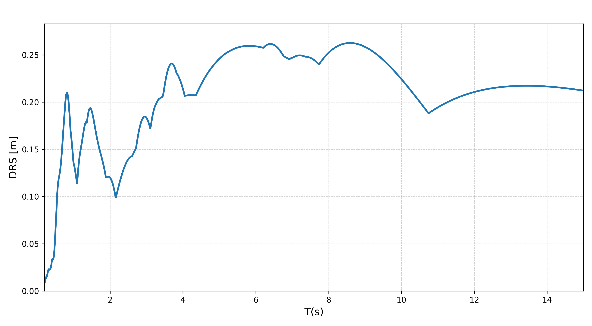
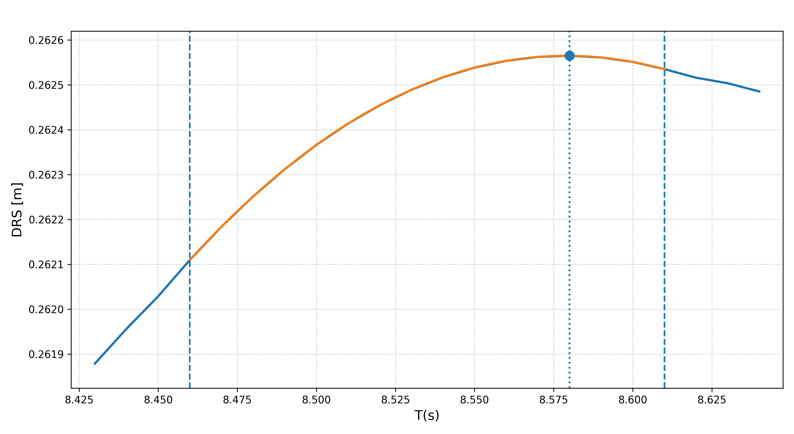

# SPECduration

SPECduration is an open-source Python package for estimating spectral seismic duration from the displacement response spectrum (DRS) of processed earthquake acceleration records.

The software automatically identifies the predominant spectral window using the second derivative of the DRS and performs harmonic fitting to estimate the spectral duration parameter `T_s`.

The fitting model is:

$$
DRS(T)=P\sin\left(\frac{\pi T_s}{T}-c\right)
$$

where `P` is the fixed maximum DRS amplitude, `T` is the natural period, and `c` is the phase parameter.

The theoretical basis of the method is described in the [associated research paper](https://doi.org/10.1177/10775463251360873).

## Features

- Displacement response spectrum computation using Newmark-beta integration.
- Automatic detection of the predominant spectral window using the second spectral derivative.
- Harmonic fitting with fixed `P` to estimate `T_s` and the coefficient of determination `R²`.
- Automatic generation of numerical results and diagnostic figures.

## Installation

SPECduration requires Python 3.9 or later.

Clone the repository and install the package:

```bash
git clone https://github.com/Lizandro-Jara/SPECduration.git
cd SPECduration
python -m pip install .
```

Alternatively, download the repository as a ZIP file, extract it, and run `python -m pip install .` from the project directory.

A virtual environment is recommended.

## Usage

Run SPECduration from the command line using a processed earthquake acceleration record:

```bash
specduration --input "examples/LOMA PRIETA.txt" --out "outputs"
```

Alternatively, execute the Python module directly:

```bash
python -m specduration.cli --input "examples/LOMA PRIETA.txt" --out "outputs"
```

The input must be a two-column `.txt` file containing time in seconds and ground acceleration in m/s², preceded by a header line.

Example:

```text
time(s)  acceleration(m/s^2)
0.00     -0.00123
0.02      0.00345
0.04     -0.00210
```

The default analysis uses a damping ratio of 5% and a spectral period step of 0.01 s.

For additional command-line options, run:

```bash
specduration --help
```

## Outputs

SPECduration generates the following files for each processed record:

**Main report**
- `results.xlsx` — Excel report containing results, DRS data, numerical derivatives, and diagnostics.

**CSV files**
- `summary.csv`
- `results_diagnostics.csv`
- `drs_full.csv`
- `second_derivative.csv`

**Diagnostic figures**
- `drs_full.png`
- `drs_window.png`
- `second_derivative_window.png`

### Displacement response spectrum



### Detected spectral window and harmonic fit



## Citation and License

If you use SPECduration in academic work, please cite the software using the information provided in [`CITATION.cff`](CITATION.cff).

SPECduration is distributed under the [MIT License](LICENSE).